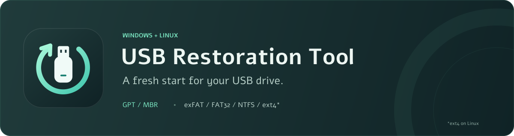
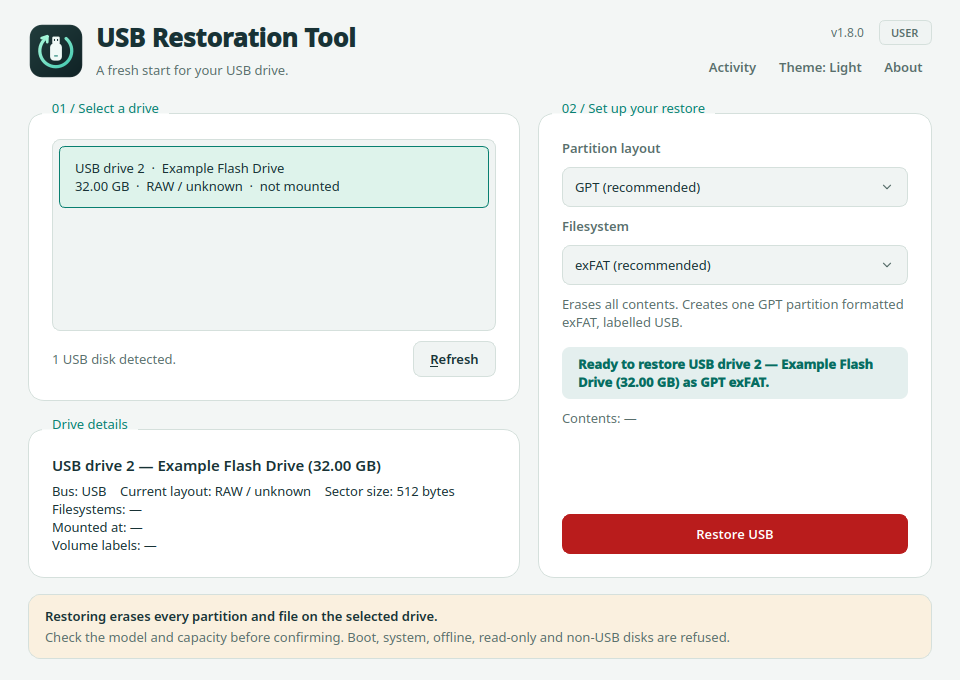

<p align="center">
  
</p>

# USB Restoration Tool

[](https://github.com/KaroqDave/USB-Restoration-Tool/actions/workflows/build.yml)
[](https://github.com/KaroqDave/USB-Restoration-Tool/releases/latest)
[](https://github.com/KaroqDave/USB-Restoration-Tool/releases/latest)
[](LICENSE)

Restore an ISO-written or unusable USB drive to one partition labelled `USB`.
Choose **GPT or MBR** and **exFAT, FAT32 or NTFS**. Linux also supports **ext4**.

Built with Qt 6 for Windows and Linux. Tested across multiple devices and systems.

> **Restoring erases every partition and file on the selected drive.** Check the
> model and capacity before confirming. Only USB disks are eligible; system,
> protected and read-only disks are refused.

<picture>
  <source media="(prefers-color-scheme: dark)" srcset="docs/images/app-dark.png">
  
</picture>

Interface preview with an example drive.

## Download and run

Get a build from [Releases](https://github.com/KaroqDave/USB-Restoration-Tool/releases/latest).

### Windows

1. Download and extract `USB-Restoration-Tool-<version>.zip`.
2. Run `usb-restoration-tool.exe` and approve the Administrator prompt.

Keep the bundled DLLs and plugin folders beside the executable. `SHA256SUMS.txt`
contains checksums for the bundle. Unsigned builds may show a SmartScreen warning.
If runtime DLLs are missing, install the
[Visual C++ Redistributable (x64)](https://aka.ms/vs/17/release/vc_redist.x64.exe).

### Linux

Restores require Linux 5.15 or later with disk-sequence support and the loop
driver available (`/dev/loop-control`).

On Ubuntu 24.04 or later and Debian 13 or later, install the `.deb`. It pulls
in the formatters and pkexec:

```bash
sudo apt install ./usb-restoration-tool_*_amd64.deb
```

An installed build runs the GUI as your normal user and asks for authentication
when restoring. Launch it from the applications menu or run `usb-restoration-tool`.
See [Development](docs/development.md) to build and install from source.

The portable AppImage runs the whole application as root:

```bash
chmod +x USB-Restoration-Tool-*-x86_64.AppImage
sudo ./USB-Restoration-Tool-*-x86_64.AppImage
```

With the AppImage or a source build, install the formatter for the filesystem you want:

| Filesystem | Debian / Ubuntu | Fedora | Arch |
| --- | --- | --- | --- |
| exFAT | `exfatprogs` | `exfatprogs` | `exfatprogs` |
| FAT32 | `dosfstools` | `dosfstools` | `dosfstools` |
| NTFS | `ntfs-3g` | `ntfsprogs` | `ntfs-3g` |
| ext4 | `e2fsprogs` | `e2fsprogs` | `e2fsprogs` |

If the AppImage cannot connect to your display, allow root access temporarily:

```bash
xhost +SI:localuser:root
sudo ./USB-Restoration-Tool-*-x86_64.AppImage
xhost -SI:localuser:root
```

If FUSE is unavailable, extract the AppImage and run it:

```bash
./USB-Restoration-Tool-*-x86_64.AppImage --appimage-extract
sudo ./squashfs-root/AppRun
```

## Restore a drive

1. Connect the USB drive and select it in the app.
2. Check its model, capacity and listed volumes.
3. Choose the partition style and filesystem. GPT and exFAT are the defaults.
4. Select **Restore USB**, read the summary, tick the acknowledgement and confirm.

**Cancel** stops the restore before destructive work begins. Existing volumes may
need remounting or drive-letter reassignment. Once destructive work starts, leave
the drive connected until the operation finishes.

The result is one volume labelled `USB`. Windows assigns a drive letter; Linux
leaves mounting to the desktop.

## Troubleshooting

Close file browsers and other programs using the drive if it cannot be unmounted
or opened. A stalled device may take time to respond; the app displays how long
it has been silent and guidance for the current stage.

**Activity** shows the session log. **Open log file** opens
`usb-restoration-tool.log`, stored beside the executable or in per-user
application data when that directory is not writable.

## What's New in 1.8.0 (unreleased)

- Confirmation, restore progress and the result now share one themed dialog,
  with animated steps, completed-step timings, elapsed time and stall guidance.
  The erase acknowledgement is still required, and cancellation is disabled
  once destructive work starts.
- After a restore, the main window rescans the drives and shows whether the
  selected drive is eligible for another restore. Retrying requires a fresh
  erase acknowledgement.
- Restore setup avoids unnecessary filesystem-detail reads. Windows reuses its
  storage connection and stops retrying permanent drive-lock errors; Linux
  clears signatures in larger writes without changing the erased range.
- Linux and Windows drive errors explain the failed operation and what to try
  next. The log now records setup, step and total restore durations.

Linux requirements are unchanged. Upgrade the installed app and helper together.

### Previously, in 1.7.2

- On Linux, a restore whose formatting step fails no longer leaves the old
  partitions showing over the new partition table.
- On Linux, a media-change event during a restore no longer makes a finished
  restore report failure.
- Linux formatting no longer fails when another program holds the free loop
  device; the app uses a different one.
- The Windows log records whether each storage operation completed immediately
  or was queued, and how a queued job ended, to help diagnose a failed restore.
- Disk-instance refusals name the disk, and new regression tests cover these
  fixes on Linux loop images and Windows storage jobs.

Linux requirements are unchanged from 1.7.1.

### Previously, in 1.7.1

- Unsupported MBR layouts are refused before a restore changes the drive.
- Linux checks the selected disk instance through the open device and keeps
  formatting bound to that disk, even if device names are reused.
- Windows stops if it cannot confirm that a queued storage operation completed
  successfully, instead of continuing after a missing or unreadable job result.
- Restore refusal messages now cover unsupported partition layouts as well as
  filesystem choices. The Windows ZIP's instructions match the current interface.
- New regression tests cover disk identity, layout limits and formatter cleanup,
  including all four Linux filesystems under ASan/UBSan.

**Linux requirement:** restores now need kernel 5.15 or later with disk-sequence
support and the loop driver. Upgrade the installed app and helper together.

### Previously, in 1.7.0

- A new USB restore icon and matching mint and ink themes across Windows and
  Linux, with refreshed project artwork.
- Drive selection, drive details and restore settings sit side by side in a
  cleaner layout, with a branded header and About dialog.
- The erase acknowledgement is easier to see, with a larger outlined checkbox,
  a contrasting checkmark and a visible keyboard focus state.
- Windows FAT32 restores no longer fail with `AllocationUnitSize` WMI error
  `0x80041005` before formatting. GPT + FAT32 has been confirmed working.
- New Windows regression tests check WMI parameter types without accessing disks.

### Previously, in 1.6.3

- On Windows, USB sticks with a bootloader written directly to the disk and no
  partition table ("superfloppies") can now be restored. This also fixes sticks
  that Windows treats as superfloppies after their partitions are removed.
- Windows now dismounts volumes mounted at a folder or without a drive letter
  before restoring, as it already did for volumes with a drive letter.

### Previously, in 1.6.2

- The Linux restore helper is stricter about what the app tells it: disk and
  sector sizes must be plain numbers, and a helper that announces itself twice
  or repeats a detail is refused.
- Long messages from the formatting tools are shortened cleanly, without a
  broken character at the end.
- The parsers on the helper boundary and the partition tables are fuzzed, and
  the core tests run under memory and undefined-behaviour checkers in CI.

See [CHANGELOG.md](CHANGELOG.md) for release history.

## Development and safety

- [Development](docs/development.md): build, test, package and project structure.
- [Linux helper](docs/polkit-helper.md): privilege separation and protocol.
- [Tasks](docs/TODO.md): remaining work.
- [Security policy](SECURITY.md): safety checks and vulnerability reporting.

## License

[MIT](LICENSE).
